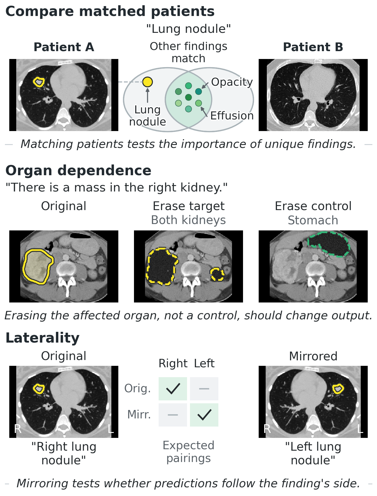
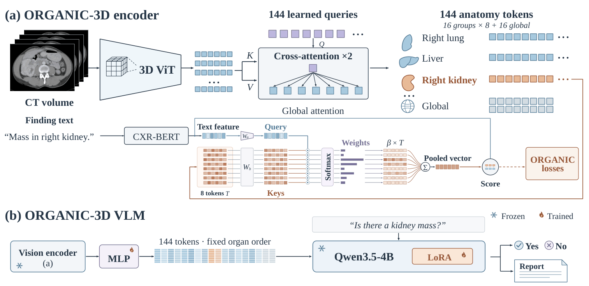
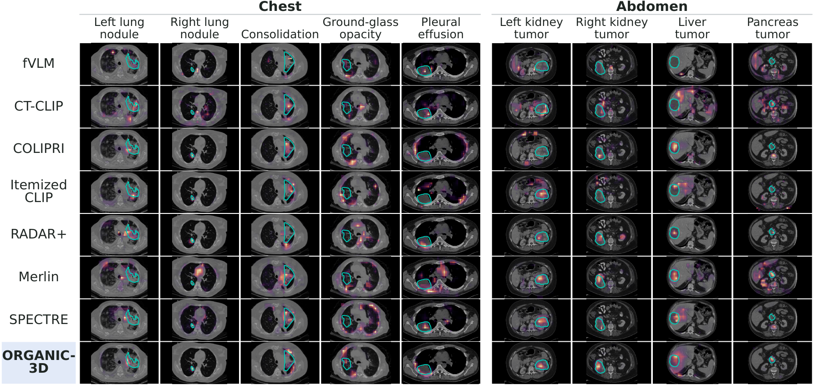
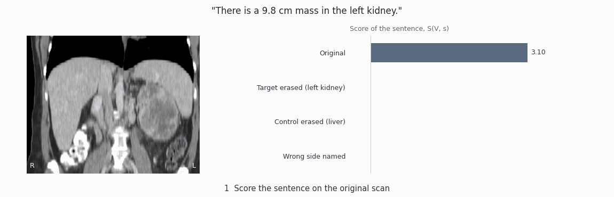
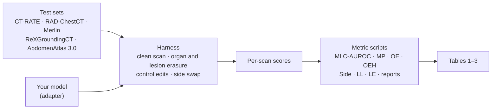

# ORGANIC-3D

**ORGANIC-3D: Grounding 3D CT Vision Language Models in Organ-Level Image–Text Coupling**

[Paper](<PAPER_URL>) · [Benchmark](https://huggingface.co/datasets/zllhhhh/organic3d-benchmark) · [Encoder weights](https://huggingface.co/zllhhhh/organic3d-encoder) · [VLM weights](https://huggingface.co/zllhhhh/organic3d-vlm)

ORGANIC-3D (ORGAN-level Image-text Coupling in 3D) tests whether the predictions of 3D CT vision–language models follow
the image evidence for each finding, and trains an encoder and a VLM to do so. This repository holds the code to train
both models, the evaluation harness that scores our models and the released baselines under the same interventions,
and the scripts that compute every metric of the paper.

<p align="center"></p>
<p align="center"><em>Alignment tests with expected responses.</em></p>

- **Tests** (`docs/metrics.md`): classification (MLC-AUROC; lesion AUROC; zero-shot tumour detection), clinical finding
  independence (matched-pair AUROC, MP), organ dependence (organ-erasure ΔAUROC, OE; for VLMs the organ-erasure hit
  rate, OEH), laterality (Side) and the lung lobe erasure hit rate (LL), and lesion erasure (LE). Every organ or lesion
  edit is compared with the same edit of a control organ or region.
- **Encoder**: the COLIPRI 3D ViT read through 144 anatomy queries (16 organ groups × 8, plus 16 global); each sentence
  is routed to the tokens of the organs it names and pooled with text-conditioned weights. Trained with the contrastive
  loss and the ORGANIC losses (organ-erasure, mirror, matched-pair and anatomy-attention losses).
- **VLM**: the frozen encoder's 144 anatomy tokens, in a fixed organ order, feed Qwen3.5-4B (LoRA) through an MLP.
  Trained with the dependence margin, the answer-attention loss and answer-first reports.
- **Datasets**: CT-RATE and Merlin (training and test), RAD-ChestCT (external), ReXGroundingCT (radiologist lesion masks
  on CT-RATE test scans) and AbdomenAtlas 3.0 (IID test split).


*ORGANIC-3D Overview.
([PDF](docs/assets/fig2_method.pdf))*

## Requirements

- **Software**: Linux, Python 3.10–3.12, PyTorch 2.14 with CUDA 12 (driver ≥ 525), and the packages in
  `requirements.txt` (pinned versions used for the paper; transformers 5.17, peft 0.21, MONAI 1.5, COLIPRI 0.1.3).
  TotalSegmentator v2 runs in its own environment, as does each released baseline (`extaudit/README.md`).
- **Hardware**: the encoder was trained on 4 × H100 80 GB (12,000 steps, about 22 h) and the VLM on 4 × B200
  (10,000 steps, about 4.4 h); evaluation runs on a single GPU.

```bash
ENV_DIR=/path/to/env bash scripts/setup/setup_env.sh        # conda env: Python 3.12, PyTorch (CUDA 12.6), requirements.txt
python scripts/setup/check_env.py                           # versions and imports, no GPU needed
cp configs/env/TEMPLATE.yaml configs/env/local.yaml   # then fill in the dataset roots and the work root
python -m pytest tests/                               # unit tests, CPU only
```

### Check the installation

- **Without GPU or data:** `python -m pytest tests/` runs unit tests of the code (losses, edits, organ routing, metrics
  and the harness end to end) on synthetic scans with random weights (`tests/README.md`).
- **GPU (needs the prepared data):** `ENV=configs/env/local.yaml GPUS=0,1,2,3 bash scripts/setup/smoke_test.sh` trains and
  evaluates both models for a few steps on 1 and on several GPUs, including resuming. A quicker check with the released
  weights is the one-CT demo (`demo/organic3d_demo.py`, see Evaluation).

## Results

All values in %. Bold: best; <u>underlined</u>: second best. Metric definitions: `docs/metrics.md`.

### Table 1. Encoders

Classification: AUROC, mean over each dataset's findings, on CTR (CT-RATE), RAD (RAD-ChestCT), MER (Merlin), MER-r (the
released Merlin labels) and ReX (ReXGroundingCT); AA3: zero-shot tumor detection on AbdomenAtlas 3.0. Alignment:
matched-pair AUROC (MP), organ-erasure ΔAUROC (OE), laterality accuracy (Side) and CT-RATE lung lobe erasure hit rate
(LL). LE: lesion-erasure hit rate. COLIPRI-FT: the COLIPRI backbone fine-tuned on the same public data, without the
ORGANIC losses.

| Model | CTR | RAD | MER | MER-r | ReX | AA3 tumor | CTR MP | CTR OE | CTR Side | CTR LL | RAD MP | RAD OE | MER MP | MER OE | MER Side | LE ReX | LE AA3 |
|:--|--:|--:|--:|--:|--:|--:|--:|--:|--:|--:|--:|--:|--:|--:|--:|--:|--:|
| CT-CLIP | 73.2 | 62.5 | 57.1 | 59.8 | 62.9 | 59.6 | 65.5 | 1.9 | 55.2 | 8.5 | 59.4 | 3.3 | 58.4 | 0.4 | 50.9 | 55.9 | 46.9 |
| CT-VocabFine | 76.0 | 65.3 | 57.0 | 59.1 | 64.6 | 60.8 | 65.9 | 5.0 | 49.5 | 19.5 | 61.6 | 3.9 | 58.2 | 0.3 | 50.6 | 51.1 | 44.8 |
| HLIP | 77.1 | 70.4 | 58.0 | 62.3 | 67.0 | 44.0 | 71.3 | 11.0 | 60.2 | 12.6 | 68.9 | 12.0 | 59.7 | −0.5 | 52.1 | 66.6 | 56.6 |
| ItemizedCLIP | 82.7 | 74.4 | 58.6 | 64.1 | 75.0 | 54.7 | 76.2 | 11.8 | <u>65.7</u> | <u>48.9</u> | 71.9 | <u>14.6</u> | 57.5 | 2.0 | 50.9 | 69.2 | 57.8 |
| COLIPRI | 82.2 | 74.8 | 65.5 | 70.8 | 73.4 | 62.7 | 77.8 | 10.5 | 51.0 | 31.3 | 75.1 | 13.4 | 67.0 | 3.2 | 49.5 | <u>70.1</u> | 64.3 |
| Jolia | 75.3 | 66.6 | 71.3 | 76.2 | 62.0 | 51.4 | 72.8 | 9.4 | 61.4 | 36.0 | 65.8 | 8.9 | 71.2 | 4.2 | 57.8 | 65.8 | 57.1 |
| Jolia, long prompts | 81.0 | 70.9 | 79.1 | 81.7 | 72.0 | 51.4 | 76.2 | 11.3 | 61.4 | 36.0 | 68.9 | 9.4 | 77.9 | 6.0 | 57.8 | 65.8 | 57.1 |
| SPECTRE | 57.3 | 57.1 | 55.3 | 62.9 | 58.6 | 51.2¶ | 55.2 | 11.3 | 50.4 | 32.8 | 55.0 | 4.8 | 54.2 | 0.0 | 50.9 | 60.5 | 69.4¶ |
| Merlin | 58.9 | 60.7 | 60.3 | 64.3 | 55.7 | 46.1 | 55.8 | 6.6 | 51.3 | 20.3 | 57.7 | 6.4 | 57.0 | 1.8 | 53.2 | 58.5 | 60.2 |
| fVLM † | 77.7 | 67.7 | 55.3 | 54.8 | 67.0 | 52.3 | 70.2 | <u>12.4</u> | 52.4 | 25.2 | 66.7 | 11.1 | 53.9 | −0.2 | 50.7 | 51.7 | 35.4 |
| ViSD-Boost † | 79.1 | 70.1 | 58.3 | 60.8 | 65.9 | 40.8 | 73.3 | 9.3 | 51.8 | 26.3 | 69.6 | 12.2 | 56.8 | 3.9 | 49.1 | 57.3 | 57.2 |
| RADAR+, Merlin-only † | 73.6 | 66.1 | 79.7 | 83.6 | 60.6 | 68.7 | 65.8 | 4.3 | 50.7 | 17.9 | 63.1 | 4.9 | 79.9 | **22.6** | 50.4 | 56.6 | 45.0 |
| RADAR+, published † | 70.3 | 64.7 | <u>83.9</u> | <u>88.2</u> | 59.4 | 68.9 | 63.4 | 2.4 | 52.9 | 22.3 | 60.5 | 6.4 | <u>83.6</u> | 20.3 | <u>57.8</u> | 62.5 | 58.5 |
| COLIPRI-FT ‡ | <u>86.4</u> | <u>77.4</u> | 82.7 | 85.0 | <u>79.1</u> | <u>72.9</u> | <u>81.2</u> | 12.1 | 52.7 | 43.8 | <u>76.5</u> | 10.4 | 81.6 | 5.8 | 52.0 | 68.4 | <u>70.1</u> |
| **ORGANIC-3D (ours)** | **87.7** | **79.7** | **87.7** | **90.1** | **79.5** | **75.0** | **82.5** | **28.5** | **76.9** | **74.7** | **78.2** | **18.4** | **86.5** | <u>21.3</u> | **63.8** | **74.9** | **70.7** |

† organ masks at test time; ‡ fine-tuned on the same public data; other released encoders use no organ masks.
¶ AbdomenAtlas images are in SPECTRE's pretraining.

### Table 2. VLMs: visual question answering

Full CT-RATE (3,002) and Merlin (5,109) test sets and 464 ReXGroundingCT scans. Answer AUROC, balanced accuracy (BACC)
and F1 of the stated answers; matched-pair AUROC (MP) and organ-erasure hit rate (OEH).

| Model | CT-RATE AUROC | CT-RATE BACC | CT-RATE F1 | CT-RATE MP | CT-RATE OEH | Merlin AUROC | Merlin BACC | Merlin F1 | Merlin MP | Merlin OEH | ReXGroundingCT AUROC | ReXGroundingCT BACC | ReXGroundingCT F1 | ReXGroundingCT MP | ReXGroundingCT OEH |
|:--|--:|--:|--:|--:|--:|--:|--:|--:|--:|--:|--:|--:|--:|--:|--:|
| Hulu-Med | 80.8 | 63.5 | 38.5 | 73.1 | 59.8 | 70.0 | 55.2 | 12.4 | 69.6 | 10.0 | 72.9 | 60.4 | 34.5 | 66.8 | 66.9 |
| OmniCT | 80.5 | 68.1 | 45.5 | 73.5 | 57.7 | 66.9 | 56.2 | 19.1 | 66.6 | 10.2 | 71.2 | 62.9 | 39.8 | 66.3 | <u>69.1</u> |
| MedGemma 1.5 | 71.5 | 60.0 | 34.2 | 64.7 | 28.6 | 66.9 | 57.2 | 20.3 | 66.0 | 17.9 | 59.6 | 55.0 | 26.2 | 58.0 | 28.9 |
| M3D-LaMed | 57.9 | 53.6 | 31.8 | 52.8 | 40.0 | 53.8 | 51.1 | 14.0 | 53.6 | −0.7 | 54.2 | 51.4 | 27.5 | 50.7 | 54.0 |
| RadFM | 54.2 | 50.4 | 21.4 | 52.4 | 18.6 | 53.7 | 50.2 | 7.9 | 56.7 | 4.9 | 53.9 | 50.4 | 19.9 | 48.6 | 17.2 |
| CT-CHAT | 67.5 | 53.2 | 33.9 | 58.8 | 11.0 | 53.4 | 49.9 | 17.1 | 52.6 | 1.1 | 58.8 | 53.5 | 35.0 | 56.1 | 10.6 |
| NV-Reason-CT | <u>86.3</u> | <u>78.0</u> | **60.2** | <u>80.9</u> | <u>67.4</u> | 74.1 | 67.8 | 27.0 | 73.8 | 46.4 | <u>78.6</u> | <u>70.4</u> | <u>48.3</u> | <u>71.7</u> | 65.2 |
| Ours, plain fine-tuning | 82.1 | 72.3 | 52.2 | 76.1 | 30.7 | <u>81.3</u> | <u>68.2</u> | <u>32.9</u> | <u>80.5</u> | <u>46.6</u> | 75.4 | 65.3 | 44.3 | 67.7 | 39.1 |
| **ORGANIC-3D VLM (ours)** | **86.3** | **78.9** | <u>58.7</u> | **82.8** | **96.8** | **87.6** | **80.0** | **40.6** | **86.0** | **96.2** | **79.5** | **72.1** | **49.0** | **74.1** | **98.9** |

### Table 3. Report generation

CT-RATE and Merlin test sets. Free-text report: finding accuracy (F1, CRG) and similarity to the reference (GREEN,
RadGraph F1). Finding-based report: F1 and image-attributable F1 (IA-F1).

**CT-RATE**

| Model | Free-text F1 | Free-text CRG | GREEN | RadGraph F1 | Finding-based F1 | IA-F1 |
|:--|--:|--:|--:|--:|--:|--:|
| Hulu-Med | 31.2 | 39.4 | 36.6 | 14.0 | 53.3 | 30.0 |
| OmniCT | 38.4 | 41.5 | **46.9** | **25.6** | 52.5 | 28.8 |
| MedGemma 1.5 | 19.9 | 36.5 | 15.8 | 10.8 | 44.1 | 18.3 |
| M3D-LaMed | 11.6 | 34.3 | 1.7 | 2.2 | 34.2 | 5.0 |
| RadFM | 7.0 | 33.6 | 1.1 | 0.7 | 31.7 | 1.8 |
| CT-CHAT | 17.3 | 37.0 | **46.9** | <u>24.9</u> | 40.5 | 13.0 |
| NV-Reason-CT | <u>56.5</u> | <u>49.6</u> | 40.6 | 18.1 | **60.0** | <u>37.3</u> |
| **ORGANIC-3D (ours)** | **56.8** | **52.9** | <u>41.9</u> | 21.5 | <u>59.6</u> | **37.6** |

**Merlin**

| Model | Free-text F1 | Free-text CRG | GREEN | RadGraph F1 | Finding-based F1 | IA-F1 |
|:--|--:|--:|--:|--:|--:|--:|
| Hulu-Med | 4.4 | 33.6 | 21.5 | 8.7 | 26.6 | 13.4 |
| OmniCT | 4.2 | 33.8 | 5.1 | 4.8 | 23.4 | 9.2 |
| MedGemma 1.5 | 9.1 | 35.4 | <u>23.3</u> | 11.0 | 23.6 | 9.5 |
| M3D-LaMed | 3.6 | 33.7 | 1.4 | 3.4 | 17.8 | 1.6 |
| RadFM | 0.8 | 33.4 | 0.3 | 0.4 | 17.5 | 1.2 |
| CT-CHAT | 1.1 | 33.6 | 3.4 | 3.4 | 17.5 | 0.9 |
| NV-Reason-CT | <u>26.2</u> | <u>38.9</u> | 19.2 | <u>19.1</u> | <u>32.0</u> | <u>20.2</u> |
| **ORGANIC-3D (ours)** | **37.7** | **49.4** | **28.9** | **31.8** | **48.2** | **37.4** |

### Table 4. Ablations

COLIPRI and plain fine-tuning compared with the anatomy-aware design, for the encoder and the VLM. OE: organ-erasure
ΔAUROC, computed on the finding score Δf for the encoder and on P(Yes) for the VLM. Configs for each row: see Training.

| Encoder | MLC CTR | MLC MER | MLC RAD | Lesion ReX | Tumor AA3 | OE CTR | OE MER | Side CTR | Side MER |
|:--|--:|--:|--:|--:|--:|--:|--:|--:|--:|
| COLIPRI | 82.2 | 65.5 | 74.8 | 73.4 | 62.7 | 10.5 | 3.2 | 51.0 | 49.5 |
| + fine-tuning | 86.4 | 82.7 | 77.4 | 79.1 | 72.9 | 12.1 | 5.8 | 52.7 | 52.0 |
| + anat. queries | 87.1 | 85.5 | 79.4 | **79.9** | 74.4 | <u>14.0</u> | 8.0 | 68.7 | **66.2** |
| + organ routing | <u>87.5</u> | **87.8** | <u>79.6</u> | 79.0 | **75.6** | 13.5 | <u>9.4</u> | <u>74.9</u> | <u>63.8</u> |
| + ORGANIC (final) | **87.7** | <u>87.7</u> | **79.7** | <u>79.5</u> | <u>75.0</u> | **28.5** | **21.3** | **76.9** | <u>63.8</u> |

| VLM | Ans. AUROC CTR | Ans. AUROC MER | Report F1 CTR | Report F1 MER | MP CTR | MP MER | OE CTR | OE MER |
|:--|--:|--:|--:|--:|--:|--:|--:|--:|
| Plain fine-tuning | 82.1 | 81.3 | 22.6 | 2.1 | 76.1 | 80.5 | 9.0 | 9.4 |
| + attention loss | 85.8 | 86.8 | <u>27.4</u> | <u>12.1</u> | 80.4 | 85.3 | 15.5 | 15.1 |
| + dependence loss | **86.4** | <u>87.3</u> | 19.8 | 10.9 | <u>82.1</u> | **86.5** | <u>21.4</u> | **23.6** |
| + answer-first (final) | <u>86.3</u> | **87.6** | **56.8** | **37.7** | **82.8** | <u>86.0</u> | **28.1** | <u>22.2</u> |

### Evidence maps


*Occlusion sensitivity for nine findings (columns) and ORGANIC-3D and released encoders (rows). Brighter: removing the
region lowers the finding's score more; each map is scaled to its own maximum. Cyan: annotated lesion.
([PDF](docs/assets/fig3_evidence_maps.pdf))*

## Repository layout

```
organic/     ORGANIC-3D encoder and VLM: model, losses, training
extaudit/    evaluation harness and adapters for the released models
scripts/
  setup/       environment checks and smoke tests
  data/        dataset preparation and the benchmark sets
  train/       training launchers
  evaluation/  one-command evaluation of a model, score export for the benchmark
  metrics/     the metric scripts behind every table (full test sets)
  analysis/    attention-map analyses
  inference/   ORGANIC-3D on a CT (also ships with the weights)
configs/     training configs, one per model in the paper
demo/        alignment tests on one CT, with an interactive interface
docs/        data preparation, metric definitions, adding a new model
tests/       unit tests of the code (CPU, synthetic data)
```

## Data

Obtain each dataset from its official source under its terms; nothing from any dataset is distributed here.

| Dataset | Use | Source |
|---|---|---|
| CT-RATE | chest training and test (v2 test set, 3,002 scans) | Hugging Face `ibrahimhamamci/CT-RATE` |
| Merlin | abdominal training and test (5,109 studies) | Stanford AIMI |
| RAD-ChestCT | external chest test (3,630 scans) | Zenodo 6406114 |
| ReXGroundingCT | radiologist lesion masks on CT-RATE test scans | Hugging Face `rajpurkarlab/ReXGroundingCT` |
| AbdomenAtlas 3.0 | IID test split (926 scans) | Hugging Face `AbdomenAtlas/AbdomenAtlas3.0Mini` |

The steps (1 mm resampling, TotalSegmentator masks, splits, report sentences, the 2 mm training cache, the test sets
and the harness sets) are in `docs/data_preparation.md`. The Merlin test labels of the paper (re-extracted
from the reports with LLMs, Sec. 4.1) are on the benchmark page (`protocol/files/merlin_test_labels.csv`); pass them with
`scripts/data/prepare_manifests.py --merlin_test_labels merlin_test_labels.csv`.

## Training

Each model of the paper has one config. Its file name is the run id, which also names the training outputs and the
evaluation results; `enc1`–`enc4` and `vlm1`–`vlm4` follow the rows of Table 4.

| Model (paper, Table 4) | Config | Run id |
|---|---|---|
| Encoder: COLIPRI + fine-tuning | `configs/encoder/enc1_finetune.yaml` | `enc1_finetune` |
| + anat. queries | `configs/encoder/enc2_queries.yaml` | `enc2_queries` |
| + organ routing | `configs/encoder/enc3_routing.yaml` | `enc3_routing` |
| + ORGANIC = **ORGANIC-3D** | `configs/encoder/enc4_organic3d.yaml` | `enc4_organic3d` |
| VLM: plain fine-tuning | `configs/vlm/vlm1_plain.yaml` | `vlm1_plain` |
| + attention loss | `configs/vlm/vlm2_attention.yaml` | `vlm2_attention` |
| + dependence loss | `configs/vlm/vlm3_dependence.yaml` | `vlm3_dependence` |
| + answer-first = **ORGANIC-3D VLM** | `configs/vlm/vlm4_organic3d.yaml` | `vlm4_organic3d` |
| vlm4 recipe on enc3, the encoder without the ORGANIC losses (not in Table 4) | `configs/vlm/vlm4_organic3d_on_enc3.yaml` | `vlm4_organic3d_on_enc3` |

```bash
# encoder: 4 GPUs, batch 4 per GPU, 12,000 steps
torchrun --nproc_per_node 4 -m organic.train_stageA --env configs/env/local.yaml --ablation configs/encoder/enc4_organic3d.yaml
# VLM on the frozen encoder ({work_root}/runs/enc4_organic3d/last.pt): 4 GPUs, 10,000 steps
torchrun --nproc_per_node 4 -m organic.train_stageB --env configs/env/local.yaml --ablation configs/vlm/vlm4_organic3d.yaml
```

Any config value can be overridden on the command line (`key=value`, e.g. `train.max_steps=100`). Wrappers:
`scripts/train/launch_local.sh`, `scripts/train/launch_stageB_local.sh`, `scripts/train/launch_multinode.sh`. Before a long run:
`python scripts/setup/preflight_cpu.py --env configs/env/local.yaml` and `bash scripts/setup/smoke_test.sh`. On Python 3.10,
`python scripts/setup/patch_triton_py310.py` fixes the Triton kernels of Qwen3.5's linear attention. Outputs:
`{work_root}/runs/<run>/` (encoder) and `{work_root}/runsB/<run>/` (VLM: LoRA, projector).

## Evaluation

### Try it on one CT

`demo/organic3d_demo.py` runs the alignment tests on a single scan for any sentence that names an organ. It scores the
sentence on the original scan, after erasing the organ the sentence names (target), after the same edit of an organ it
does not name (control), and with left and right swapped:

```bash
python demo/organic3d_demo.py --ct ct.nii.gz --seg seg.nii.gz --region abdomen \
    --sentence "There is a 9.8 cm mass in the left kidney." --out example.png
python demo/organic3d_demo.py --app        # the same in an interactive web interface (pip install gradio matplotlib)
```

<p align="center"></p>

*AbdomenAtlas 3.0 test scan BDMAP_00002434 (CC BY-NC-SA 4.0), coronal view. The script also writes this as one summary
image (`--out`) and the scores as JSON.*

### Evaluate a model on the benchmark

One command runs every harness step and metric of the paper for one model:



```bash
python scripts/evaluation/evaluate.py encoder --model organic3d_enc --ckpt zllhhhh/organic3d-encoder --name enc4_organic3d
python scripts/evaluation/evaluate.py vlm --model organic3d_vlm --ckpt zllhhhh/organic3d-vlm --name vlm4_organic3d
```

| Option | Values |
|---|---|
| `--tests` (encoder) | `mlc` (MLC-AUROC, MP, OE), `ll`, `side`, `lesion`, `tumour`, `le`; default all |
| `--tests` (VLM) | `answers` (AUROC, BACC, F1, MP, OEH), `reports` (free-text and finding-based reports); default all |
| `--model_python` | the python of a released model's own environment (`extaudit/README.md`); metrics run in this one |
| `--dry_run` | print the commands without running them |

`--ckpt` takes the released weights (a Hugging Face repo id or a downloaded folder) or a training checkpoint
(`<work_root>/runs/<run id>/last.pt`; VLM: `<work_root>/runsB/<run id>::<encoder last.pt>`); both give the paper's scores
exactly. Without arguments, `python scripts/evaluation/evaluate.py` asks for each option. Scores go to `{work_root}/extaudit/out*/<name>/`
and metrics to `{work_root}/eval/`. To add a new model, write an adapter (`docs/adapter_guide.md`); metric definitions
are in `docs/metrics.md`.

The supplementary analyses run through the same harness: fills that no training step uses
(`python -m extaudit.core ... --fills water,median,blur`, `python -m extaudit.vlm_core ... --fills median --no_mirror`,
then `scripts/metrics/oeh_breakdown.py`) and the evidence maps of Figure 3 (`--task occlusion`).

## Inference

```bash
python scripts/inference/organic3d.py encoder --ct scan.nii.gz --region chest --totalseg            # finding and sentence scores
python scripts/inference/organic3d.py vlm --ct scan.nii.gz --region chest --totalseg --report      # yes/no answers and a report
```

`scripts/inference/organic3d.py` is the same script that ships with the weights (Hugging Face `zllhhhh/organic3d-encoder`,
`zllhhhh/organic3d-vlm`): 1 mm RAS resampling, crop
centre from TotalSegmentator, then the encoder and the VLM.

## Citation

```bibtex
<CITATION>
```

## Licence

Code: Apache-2.0 (`LICENSE`). Datasets, released baselines and our weights keep their own terms (CT-RATE and
AbdomenAtlas 3.0 CC BY-NC-SA 4.0; Merlin, RAD-ChestCT and ReXGroundingCT under their providers' terms). Not for
clinical use.
