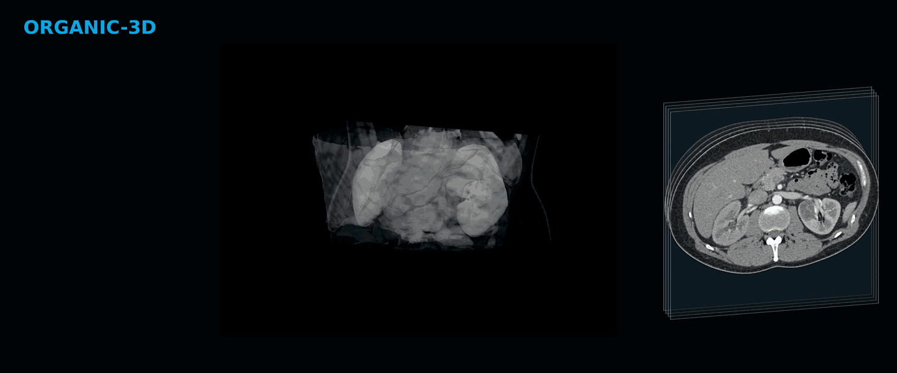

# ORGANIC-3D

**ORGANIC-3D: Grounding 3D CT Vision Language Models in Organ-Level Image–Text Coupling**

<p align="center">
  <a href="https://arxiv.org/abs/2611.23529"></a>
  <a href="https://huggingface.co/zllhhhh/organic3d-encoder"></a>
  <a href="https://huggingface.co/zllhhhh/organic3d-vlm"></a>
  <a href="https://huggingface.co/datasets/zllhhhh/organic3d-benchmark"></a>
  <a href="LICENSE"></a>
</p>

ORGANIC-3D tests whether a 3D CT model's prediction for a finding comes from the image evidence for that finding, and
trains an encoder and a VLM that pass these tests. 

<p align="center"></p>
<p align="center"><em>Is there a mass in the left kidney? And do VLMs answer with the correct anatomical evidence?</em></p>

## Contents

- [Install](#install)
- [Quick start](#quick-start)
- [Data](#data)
- [Evaluate a model](#evaluate-a-model)
- [Train](#train)
- [Results](#results)
- [Repository layout](#repository-layout)
- [Citation and licence](#citation-and-licence)

## Install

```bash
git clone https://github.com/lzl199704/organic3d && cd organic3d
ENV_DIR=/path/to/env bash scripts/setup/setup_env.sh   # Python 3.12, PyTorch 2.14, requirements.txt; ends with an env check
cp configs/env/TEMPLATE.yaml configs/env/local.yaml    # fill in the dataset roots and the work root
python -m pytest tests/                                # CPU-only check on synthetic scans, no data needed
```

- **Separate environments:** TotalSegmentator v2 (organ masks), the report metrics (last section of `requirements.txt`,
  Java 17 on `PATH`) and each released baseline (`extaudit/README.md`).
- **GPU:** PyTorch's CUDA 12.6 build (driver ≥ 525) or CUDA 13. One GPU is enough for evaluation; the paper trained the
  encoder on 4 × H100 (22 h) and the VLM on 4 × B200 (4.4 h).
- **End-to-end check with data:** `ENV=configs/env/local.yaml GPUS=0,1,2,3 bash scripts/setup/smoke_test.sh`.

## Quick start

Run the alignment tests on one CT for any sentence that names an organ. The released weights download automatically.

```bash
python demo/organic3d_demo.py --ct ct.nii.gz --seg seg.nii.gz --region abdomen \
    --sentence "There is a 9.8 cm mass in the left kidney." --out example.png
python demo/organic3d_demo.py --app        # interactive web interface (pip install gradio matplotlib)
```

<p align="center"></p>

*The sentence is scored on the original scan, after erasing the organ it names (target), after the same edit of another
organ (control) and with left and right swapped. AbdomenAtlas 3.0 test scan BDMAP_00002434 (CC BY-NC-SA 4.0).*

Scores and reports for your own scan:

```bash
python scripts/inference/organic3d.py encoder --ct scan.nii.gz --region chest --totalseg            # finding and sentence scores
python scripts/inference/organic3d.py vlm --ct scan.nii.gz --region chest --totalseg --report      # yes/no answers and a report
```

## Data

No data is distributed here; get each dataset from its source under its terms.

| Dataset | Use | Source |
|---|---|---|
| CT-RATE | chest training and test (v2 test set, 3,002 scans) | Hugging Face `ibrahimhamamci/CT-RATE` |
| Merlin | abdominal training and test (5,109 studies) | Stanford AIMI |
| RAD-ChestCT | external chest test (3,630 scans) | Zenodo 6406114 |
| ReXGroundingCT | radiologist lesion masks on CT-RATE test scans | Hugging Face `rajpurkarlab/ReXGroundingCT` |
| AbdomenAtlas 3.0 | IID test split (926 scans) | Hugging Face `AbdomenAtlas/AbdomenAtlas3.0Mini` |

Preparation steps: [`docs/data_preparation.md`](docs/data_preparation.md). The paper's Merlin test labels are on the
[benchmark page](https://huggingface.co/datasets/zllhhhh/organic3d-benchmark) (`protocol/files/merlin_test_labels.csv`).

## Evaluate a model


One command runs every test and metric of the paper for one model:

```bash
python scripts/evaluation/evaluate.py encoder --model organic3d_enc --ckpt zllhhhh/organic3d-encoder --name enc4_organic3d
python scripts/evaluation/evaluate.py vlm --model organic3d_vlm --ckpt zllhhhh/organic3d-vlm --name vlm4_organic3d \
    --report_python <report env>/bin/python
```

| Option | Values |
|---|---|
| `--tests` | encoder: `mlc`, `ll`, `side`, `lesion`, `tumour`, `le`; VLM: `answers`, `reports` (default: all) |
| `--model_python` | python of a released model's own environment (harness steps) |
| `--report_python` | python of the report environment (free-text report metrics) |
| `--dry_run` | print the steps without running them |

Scores go to `{work_root}/extaudit/`, metrics to `{work_root}/eval/`. To test a new model, write an adapter
([`docs/adapter_guide.md`](docs/adapter_guide.md)); metric definitions are in [`docs/metrics.md`](docs/metrics.md).

## Train

Each model of the paper has one config; its file name is the run id used for the outputs.

| Model (Table 4) | Config |
|---|---|
| Encoder: COLIPRI + fine-tuning | `configs/encoder/enc1_finetune.yaml` |
| + anatomy queries | `configs/encoder/enc2_queries.yaml` |
| + organ routing | `configs/encoder/enc3_routing.yaml` |
| + ORGANIC losses = **ORGANIC-3D** | `configs/encoder/enc4_organic3d.yaml` |
| VLM: plain fine-tuning | `configs/vlm/vlm1_plain.yaml` |
| + attention loss | `configs/vlm/vlm2_attention.yaml` |
| + dependence loss | `configs/vlm/vlm3_dependence.yaml` |
| + answer-first = **ORGANIC-3D VLM** | `configs/vlm/vlm4_organic3d.yaml` |

```bash
# encoder: 4 GPUs, 12,000 steps
torchrun --nproc_per_node 4 -m organic.encoder.train --env configs/env/local.yaml --ablation configs/encoder/enc4_organic3d.yaml
# VLM on the frozen encoder ({work_root}/runs/enc4_organic3d/last.pt): 4 GPUs, 10,000 steps
torchrun --nproc_per_node 4 -m organic.vlm.train --env configs/env/local.yaml --ablation configs/vlm/vlm4_organic3d.yaml
```

Override any config value with `key=value` (e.g. `train.max_steps=100`). Outputs: `{work_root}/runs/<run id>/`
(encoder) and `{work_root}/runsB/<run id>/` (VLM).

## Results


*Method overview ([PDF](docs/assets/fig2_method.pdf)). Encoder: COLIPRI's 3D ViT read by 144 anatomy queries; each
sentence reads the queries of the organs it names; trained with the organ-erasure, mirror, matched-pair and
anatomy-attention losses. VLM: the anatomy tokens feed Qwen3.5-4B, trained with the dependence and attention losses
and answer-first reports.*

All values in %; bold: best, <u>underlined</u>: second best. Click a table to expand it.

<details>
<summary><b>Table 1. Encoders</b>: best on every classification set and every alignment test, except Merlin OE, where
the mask-gated RADAR+ Merlin-only leads.</summary>

<br>

Classification AUROC on CTR (CT-RATE), RAD (RAD-ChestCT), MER (Merlin; MER-r: the released Merlin labels) and ReX
(ReXGroundingCT); AA3: zero-shot tumour detection on AbdomenAtlas 3.0. MP: matched-pair AUROC; OE: organ-erasure
ΔAUROC; Side: laterality accuracy; LL: lung lobe erasure hit rate; LE: lesion-erasure hit rate. COLIPRI-FT: COLIPRI
fine-tuned on the same public data, without our anatomy queries, routing and losses.

| Model | CTR | RAD | MER | MER-r | ReX | AA3 tumor | CTR MP | CTR OE | CTR Side | CTR LL | RAD MP | RAD OE | MER MP | MER OE | MER Side | LE ReX | LE AA3 |
|:--|--:|--:|--:|--:|--:|--:|--:|--:|--:|--:|--:|--:|--:|--:|--:|--:|--:|
| CT-CLIP | 73.2 | 62.5 | 57.1 | 59.8 | 62.9 | 59.6 | 65.5 | 1.9 | 55.2 | 8.5 | 59.4 | 3.3 | 58.4 | 0.4 | 50.9 | 55.9 | 46.9 |
| CT-VocabFine | 76.0 | 65.3 | 57.0 | 59.1 | 64.6 | 60.8 | 65.9 | 5.0 | 49.5 | 19.5 | 61.6 | 3.9 | 58.2 | 0.3 | 50.6 | 51.1 | 44.8 |
| HLIP | 77.1 | 70.4 | 58.0 | 62.3 | 67.0 | 44.0 | 71.3 | 11.0 | 60.2 | 12.6 | 68.9 | 12.0 | 59.7 | −0.5 | 52.1 | 66.6 | 56.6 |
| ItemizedCLIP | 82.7 | 74.4 | 58.6 | 64.1 | 75.0 | 54.7 | 76.2 | 11.8 | <u>65.7</u> | <u>48.9</u> | 71.9 | <u>14.6</u> | 57.5 | 2.0 | 50.9 | 69.2 | 57.8 |
| COLIPRI | 82.2 | 74.8 | 65.5 | 70.8 | 73.4 | 62.7 | 77.8 | 10.5 | 51.0 | 31.3 | 75.1 | 13.4 | 67.0 | 3.2 | 49.5 | <u>70.1</u> | 64.3 |
| Jolia | 75.3 | 66.6 | 71.3 | 76.2 | 62.0 | 51.4 | 72.8 | 9.4 | 61.4 | 36.0 | 65.8 | 8.9 | 71.2 | 4.2 | 57.8 | 65.8 | 57.1 |
| Jolia, long prompts | 81.0 | 70.9 | 79.1 | 81.7 | 72.0 | 51.4 | 76.2 | 11.3 | 61.4 | 36.0 | 68.9 | 9.4 | 77.9 | 6.0 | 57.8 | 65.8 | 57.1 |
| SPECTRE | 57.3 | 57.1 | 55.3 | 62.9 | 58.6 | 51.2¶ | 55.2 | 11.3 | 50.4 | 32.8 | 55.0 | 4.8 | 54.2 | 0.0 | 50.9 | 60.5 | 69.4¶ |
| Merlin | 58.9 | 60.7 | 60.3 | 64.3 | 55.7 | 46.1 | 55.8 | 6.6 | 51.3 | 20.3 | 57.7 | 6.4 | 57.0 | 1.8 | 53.2 | 58.5 | 60.2 |
| fVLM † | 77.7 | 67.7 | 55.3 | 54.8 | 67.0 | 52.3 | 70.2 | <u>12.4</u> | 52.4 | 25.2 | 66.7 | 11.1 | 53.9 | −0.2 | 50.7 | 51.7 | 35.4 |
| ViSD-Boost † | 79.1 | 70.1 | 58.3 | 60.8 | 65.9 | 40.8 | 73.3 | 9.3 | 51.8 | 26.3 | 69.6 | 12.2 | 56.8 | 3.9 | 49.1 | 57.3 | 57.2 |
| RADAR+, Merlin-only † | 73.6 | 66.1 | 79.7 | 83.6 | 60.6 | 68.7 | 65.8 | 4.3 | 50.7 | 17.9 | 63.1 | 4.9 | 79.9 | **22.6** | 50.4 | 56.6 | 45.0 |
| RADAR+, published † | 70.3 | 64.7 | <u>83.9</u> | <u>88.2</u> | 59.4 | 68.9 | 63.4 | 2.4 | 52.9 | 22.3 | 60.5 | 6.4 | <u>83.6</u> | 20.3 | <u>57.8</u> | 62.5 | 58.5 |
| COLIPRI-FT ‡ | <u>86.4</u> | <u>77.4</u> | 82.7 | 85.0 | <u>79.1</u> | <u>72.9</u> | <u>81.2</u> | 12.1 | 52.7 | 43.8 | <u>76.5</u> | 10.4 | 81.6 | 5.8 | 52.0 | 68.4 | <u>70.1</u> |
| **ORGANIC-3D (ours)** | **87.7** | **79.7** | **87.7** | **90.1** | **79.5** | **75.0** | **82.5** | **28.5** | **76.9** | **74.7** | **78.2** | **18.4** | **86.5** | <u>21.3</u> | **63.8** | **74.9** | **70.7** |

† organ masks at test time; ‡ fine-tuned on the same public data; other released encoders use no organ masks.
¶ AbdomenAtlas images are in SPECTRE's pretraining.

</details>

<details>
<summary><b>Table 2. VLM question answering</b>: OEH 96–99 vs at most 69 for released VLMs; level with NV-Reason-CT on
CT-RATE answer AUROC and ahead on Merlin and ReXGroundingCT.</summary>

<br>

Full CT-RATE (3,002) and Merlin (5,109) test sets and 464 ReXGroundingCT scans. AUROC, balanced accuracy (BACC) and F1
of the stated answers; MP: matched-pair AUROC; OEH: organ-erasure hit rate.

| Model | CT-RATE AUROC | CT-RATE BACC | CT-RATE F1 | CT-RATE MP | CT-RATE OEH | Merlin AUROC | Merlin BACC | Merlin F1 | Merlin MP | Merlin OEH | ReXGroundingCT AUROC | ReXGroundingCT BACC | ReXGroundingCT F1 | ReXGroundingCT MP | ReXGroundingCT OEH |
|:--|--:|--:|--:|--:|--:|--:|--:|--:|--:|--:|--:|--:|--:|--:|--:|
| Hulu-Med | 80.8 | 63.5 | 38.5 | 73.1 | 59.8 | 70.0 | 55.2 | 12.4 | 69.6 | 10.0 | 72.9 | 60.4 | 34.5 | 66.8 | 66.9 |
| OmniCT | 80.5 | 68.1 | 45.5 | 73.5 | 57.7 | 66.9 | 56.2 | 19.1 | 66.6 | 10.2 | 71.2 | 62.9 | 39.8 | 66.3 | <u>69.1</u> |
| MedGemma 1.5 | 71.5 | 60.0 | 34.2 | 64.7 | 28.6 | 66.9 | 57.2 | 20.3 | 66.0 | 17.9 | 59.6 | 55.0 | 26.2 | 58.0 | 28.9 |
| M3D-LaMed | 57.9 | 53.6 | 31.8 | 52.8 | 40.0 | 53.8 | 51.1 | 14.0 | 53.6 | −0.7 | 54.2 | 51.4 | 27.5 | 50.7 | 54.0 |
| RadFM | 54.2 | 50.4 | 21.4 | 52.4 | 18.6 | 53.7 | 50.2 | 7.9 | 56.7 | 4.9 | 53.9 | 50.4 | 19.9 | 48.6 | 17.2 |
| CT-CHAT | 67.5 | 53.2 | 33.9 | 58.8 | 11.0 | 53.4 | 49.9 | 17.1 | 52.6 | 1.1 | 58.8 | 53.5 | 35.0 | 56.1 | 10.6 |
| NV-Reason-CT | <u>86.3</u> | <u>78.0</u> | **60.2** | <u>80.9</u> | <u>67.4</u> | 74.1 | 67.8 | 27.0 | 73.8 | 46.4 | <u>78.6</u> | <u>70.4</u> | <u>48.3</u> | <u>71.7</u> | 65.2 |
| Ours, plain fine-tuning | 82.1 | 72.3 | 52.2 | 76.1 | 30.7 | <u>81.3</u> | <u>68.2</u> | <u>32.9</u> | <u>80.5</u> | <u>46.6</u> | 75.4 | 65.3 | 44.3 | 67.7 | 39.1 |
| **ORGANIC-3D VLM (ours)** | **86.3** | **78.9** | <u>58.7</u> | **82.8** | **96.8** | **87.6** | **80.0** | **40.6** | **86.0** | **96.2** | **79.5** | **72.1** | **49.0** | **74.1** | **98.9** |

</details>

<details>
<summary><b>Table 3. Report generation</b>: best free-text finding F1 and CRG on both datasets.</summary>

<br>

Free-text report: F1 and CRG of the findings extracted from it, GREEN and RadGraph F1 against the reference.
Finding-based report: F1 and image-attributable F1 (IA-F1).

**CT-RATE**

| Model | Free-text F1 | Free-text CRG | GREEN | RadGraph F1 | Finding-based F1 | IA-F1 |
|:--|--:|--:|--:|--:|--:|--:|
| Hulu-Med | 31.2 | 39.4 | 36.6 | 14.0 | 53.3 | 30.0 |
| OmniCT | 38.4 | 41.5 | **46.9** | **25.6** | 52.5 | 28.8 |
| MedGemma 1.5 | 19.9 | 36.5 | 15.8 | 10.8 | 44.1 | 18.3 |
| M3D-LaMed | 11.6 | 34.3 | 1.7 | 2.2 | 34.2 | 5.0 |
| RadFM | 7.0 | 33.6 | 1.1 | 0.7 | 31.7 | 1.8 |
| CT-CHAT | 17.3 | 37.0 | **46.9** | <u>24.9</u> | 40.5 | 13.0 |
| NV-Reason-CT | <u>56.5</u> | <u>49.6</u> | 40.6 | 18.1 | **60.0** | <u>37.3</u> |
| **ORGANIC-3D VLM (ours)** | **56.8** | **52.9** | <u>41.9</u> | 21.5 | <u>59.6</u> | **37.6** |

**Merlin**

| Model | Free-text F1 | Free-text CRG | GREEN | RadGraph F1 | Finding-based F1 | IA-F1 |
|:--|--:|--:|--:|--:|--:|--:|
| Hulu-Med | 4.4 | 33.6 | 21.5 | 8.7 | 26.6 | 13.4 |
| OmniCT | 4.2 | 33.8 | 5.1 | 4.8 | 23.4 | 9.2 |
| MedGemma 1.5 | 9.1 | 35.4 | <u>23.3</u> | 11.0 | 23.6 | 9.5 |
| M3D-LaMed | 3.6 | 33.7 | 1.4 | 3.4 | 17.8 | 1.6 |
| RadFM | 0.8 | 33.4 | 0.3 | 0.4 | 17.5 | 1.2 |
| CT-CHAT | 1.1 | 33.6 | 3.4 | 3.4 | 17.5 | 0.9 |
| NV-Reason-CT | <u>26.2</u> | <u>38.9</u> | 19.2 | <u>19.1</u> | <u>32.0</u> | <u>20.2</u> |
| **ORGANIC-3D VLM (ours)** | **37.7** | **49.4** | **28.9** | **31.8** | **48.2** | **37.4** |

</details>

<details>
<summary><b>Table 4. Ablations</b>: anatomy queries and routing add laterality; the ORGANIC losses double the
organ-erasure ΔAUROC; answer-first training recovers report F1.</summary>

<br>

OE is computed on the finding score Δf for the encoder and on P(Yes) for the VLM. The config of each row is listed
under [Train](#train).

| Encoder | MLC CTR | MLC MER | MLC RAD | Lesion ReX | Tumor AA3 | OE CTR | OE MER | Side CTR | Side MER |
|:--|--:|--:|--:|--:|--:|--:|--:|--:|--:|
| COLIPRI | 82.2 | 65.5 | 74.8 | 73.4 | 62.7 | 10.5 | 3.2 | 51.0 | 49.5 |
| + fine-tuning | 86.4 | 82.7 | 77.4 | 79.1 | 72.9 | 12.1 | 5.8 | 52.7 | 52.0 |
| + anat. queries | 87.1 | 85.5 | 79.4 | **79.9** | 74.4 | <u>14.0</u> | 8.0 | 68.7 | **66.2** |
| + organ routing | <u>87.5</u> | **87.8** | <u>79.6</u> | 79.0 | **75.6** | 13.5 | <u>9.4</u> | <u>74.9</u> | <u>63.8</u> |
| + ORGANIC (final) | **87.7** | <u>87.7</u> | **79.7** | <u>79.5</u> | <u>75.0</u> | **28.5** | **21.3** | **76.9** | <u>63.8</u> |

| VLM | Ans. AUROC CTR | Ans. AUROC MER | Report F1 CTR | Report F1 MER | MP CTR | MP MER | OE CTR | OE MER |
|:--|--:|--:|--:|--:|--:|--:|--:|--:|
| Plain fine-tuning | 82.1 | 81.3 | 22.6 | 2.1 | 76.1 | 80.5 | 9.0 | 9.4 |
| + attention loss | 85.8 | 86.8 | <u>27.4</u> | <u>12.1</u> | 80.4 | 85.3 | 15.5 | 15.1 |
| + dependence loss | **86.4** | <u>87.3</u> | 19.8 | 10.9 | <u>82.1</u> | **86.5** | <u>21.4</u> | **23.6** |
| + answer-first (final) | <u>86.3</u> | **87.6** | **56.8** | **37.7** | **82.8** | <u>86.0</u> | **28.1** | <u>22.2</u> |

</details>

<details>
<summary><b>Evidence maps</b>: where each encoder's score comes from.</summary>

<br>


*Occlusion sensitivity for nine findings (columns) and eight encoders (rows). Brighter: removing the region lowers the
finding's score more. Cyan: annotated lesion. ([PDF](docs/assets/fig3_evidence_maps.pdf))*

</details>

## Repository layout

```
organic/        ORGANIC-3D package: data/ (dataset, interventions), encoder/, vlm/, baselines/ (wrappers)
extaudit/       evaluation harness and adapters for the released models
scripts/        setup/, data/, train/, evaluation/, metrics/, analysis/, inference/  (scripts/README.md)
configs/        one config per model of the paper
demo/           alignment tests on one CT, with an interactive interface
docs/           data preparation, metric definitions, adding a new model
tests/          CPU unit tests on synthetic data
```

## Citation and licence

```bibtex
@article{liu2026organic3d,
  title   = {ORGANIC3D: Grounding 3D CT Vision Language Models in Organ Level Image Text Coupling},
  author  = {Liu, Zelong and Ahmed, Hamza and Lee, Wynn Wingyi and Torjman, Mickael and Dimitrakakis, Alexander and
             Lu, Jiahua and Deyer, Timothy and Taouli, Bachir and Fayad, Zahi A. and Mei, Xueyan},
  journal = {arXiv preprint arXiv:2611.23529},
  year    = {2026}
}
```

Code: Apache-2.0 (`LICENSE`). Datasets, released baselines and our weights keep their own terms (CT-RATE and
AbdomenAtlas 3.0: CC BY-NC-SA 4.0; Merlin, RAD-ChestCT and ReXGroundingCT: their providers' terms). Not for clinical use.
